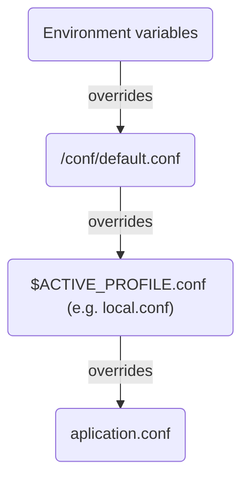

# Environment Specific Configuration
This library wraps Typesafe's config library and adds environment specific features to it.
The problem was that we needed to set different config files for each environment.
That's why I developed this tool.

It works by reading an environment variable named `ACTIVE_PROFILE` and looking for a
file named `$ACTIVE_PROFILE.conf`. If no `ACTIVE_PROFILE` env is set, it will be set to
`local` by default. Also, the fallback file is `application.conf`; so if no other config
files exist (like `local.conf`), the configs in `application.conf` will be used.

There is also another file named `default.conf` that overrides all other files if
it exists. The `EnvironmentSpecificConfig` will check `/conf` directory for a file
named `default.conf`. It is totally optional - we prefer this method for production.

This is how configs are overrided:


### How to use
After creating config files, you can create an instance of the `EnvironmentSpecificConfig`
and can methods on it to access configs.

```
val config = new EnvironmentSpecificConfig

val version = config("version")
val amount = config.getInt("amount")
val multipleConfigs = config.getInt("multiple-configs")
```

If you want to check the `ACTIVE_PROFILE` that's in use:
``` 
println(config.selectedProfile) 
```

You can use these methods as `getOrElse`:
```
config.confOrElse("non-existent-string", "anotherString")
config.confOrElse("non-existent-int", 6841)
```

You can also refer to tests to see how to use the library.
## Resolution contract and verification

Scalar getters and `confOrElse` resolve `service.port` from `service_port`
first, then root config, selected profile, and application defaults. The supplied
fallback is used only when the key is absent; malformed integers and explicit
nulls fail rather than silently replacing deployment mistakes.

`getConfig("service")` applies the same environment overrides to existing object
leaves. Environment-only scalar keys are supported, but arbitrary new nested
objects cannot be inferred from ambiguous underscore names.

For isolated tests or embedding, pass an environment snapshot and optional config:

```scala
new EnvironmentSpecificConfig(Map("service_port" -> "6543"), Some(fileConfig))
```

No reflection or process environment mutation is necessary. Run `sbt +test` to
verify both supported Scala versions. Tests cover environment-only defaults,
conflicting values, nested getters, invalid integers, nulls and instance isolation.
